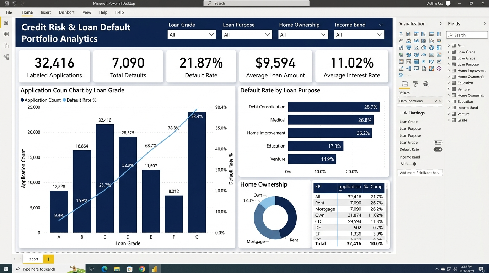

# Credit Risk & Loan Default Analytics

A reproducible intermediate-level portfolio project using **SQL**, **Python**, and **Power BI** to evaluate credit default probability, borrower risk profiles, and portfolio performance.

---

## 📊 Power BI Dashboard Preview



---

## 📌 Executive Summary & Key Insights

From an analysis of **32,416 deduplicated loan applications**, the portfolio yields the following descriptive findings:

| Key Performance Indicator | Metric Value | Business Interpretation |
| :--- | :--- | :--- |
| **Total Evaluated Applications** | **32,416** | Cleaned and labeled historical applicants |
| **Total Defaults** | **7,090** | Applicants who defaulted on repayment |
| **Overall Default Rate** | **21.87%** | Portfolio-wide historical default frequency |
| **Average Loan Amount** | **$9,594** | Median loan amount stands at $8,000 |
| **Average Interest Rate** | **11.02%** | Spanning from 7.33% (Grade A) to 20.25% (Grade G) |

### Strategic Findings:
1. **Exponential Default Risk across Credit Grades:**
   * **Grade A** applicants exhibit a low **9.96%** default rate (Avg Interest: 7.33%).
   * Default rates escalate monotonically through **Grade D (59.06%)**, **Grade F (70.54%)**, up to **Grade G (98.44%)**, confirming that credit grading strongly aligns with realized default risk.
2. **Loan Purpose Variations:**
   * **Debt Consolidation** (28.68%) and **Medical** (26.76%) loans carry the highest default risk.
   * **Venture** (14.85%) and **Education** (17.25%) loans demonstrate the highest repayment stability.
3. **Debt-to-Income Burden:**
   * Borrowers whose loan burden exceeds 30% of annual income experience noticeably elevated default rates compared to borrowers under 15%.

---

## 📂 Project Structure

```text
Credit-Risk-Analytics/
├── data/
│   ├── raw/                # Raw source dataset (credit_risk_dataset.csv)
│   └── processed/          # Cleaned CSVs and exported KPI summary tables
├── powerbi/
│   ├── dashboard_preview.png # Power BI dashboard preview image
│   ├── dashboard_spec.md     # Visual design, page layouts, and chart specifications
│   └── measures.dax          # Formatted DAX measures
├── sql/
│   ├── 01_schema.sql         # SQLite-compatible table definitions & indexes
│   └── 02_kpi_analysis.sql   # Portfolio queries, CTEs, and window functions
├── src/
│   └── analyze.py            # Automated end-to-end Python pipeline
├── requirements.txt          # Python dependencies
└── README.md                 # Project documentation
```

---

## 💾 Dataset
Download the public Kaggle **Credit Risk Dataset**: [Kaggle Credit Risk Dataset](https://www.kaggle.com/datasets/laotse/credit-risk-dataset).  
Place `credit_risk_dataset.csv` in `data/raw/`. Do not commit full raw datasets unless permitted by license.

---

## 🚀 How to Run the Pipeline (Python 3.10+)

```bash
# 1. Create and activate a virtual environment
python -m venv .venv
# Windows: .venv\Scripts\activate  | macOS/Linux: source .venv/bin/activate

# 2. Install dependencies
pip install -r requirements.txt

# 3. Run data cleaning, validation, and analytics export
python src/analyze.py --input data/raw/credit_risk_dataset.csv --output data/processed
```

The script validates required columns, reports data-quality issues (`data_quality.csv`), removes duplicate entries, sanitizes invalid values, and computes summary KPI tables for Power BI.

---

## 🗄️ SQL Analytics
`sql/` contains SQLite-compatible queries:
* `sql/01_schema.sql`: Table structure and performance indexes.
* `sql/02_kpi_analysis.sql`: Multi-dimensional aggregations, CTEs, and window ranking (`DENSE_RANK()`) by risk grade.

---

## 📈 Power BI Setup
1. Open **Power BI Desktop**.
2. Import the cleaned files from `data/processed/`.
3. Add measures from `powerbi/measures.dax`.
4. Build the visuals following layout guidelines in `powerbi/dashboard_spec.md`.

---

## ⚖️ Responsible Use & Caveats
This project is an educational analysis of an open-access credit risk dataset and does not constitute credit underwriting or credit decision advice.
